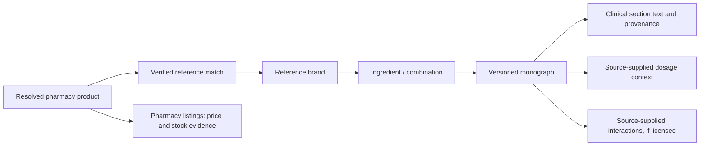

# Clinical reference enrichment before the dashboard revamp

Prepared 14 October 2026. This extends the revamp scope with a data-preparation stage; it does not certify the clinical content or replace the current dashboard snapshot.

## Decision

Yes: the requested information can fit into both spreadsheet exports and the revamped dashboard. Much of it is already in the local Drug Index files. Use a separate ingredient/monograph reference layer, linked to brands and pharmacy products through explicit identifiers, rather than copying large clinical paragraphs into every pharmacy listing row.

Drug Index's public site describes medicine reference content, prices, clinical details, and paid offline access. Publicly accessible documentation inspected for this assessment did not establish a bulk API contract, endpoint schema, or redistribution entitlement. The user confirmed that no API documentation/export is currently available and requested preparation using existing local data. No authenticated or anonymous-backend acquisition of gated clinical content was attempted. [Drug Index](https://www.drugindex.it/), [subscription description](https://www.drugindex.it/subscribe/plans?next=/drug-database).

## 1. Measured local field coverage

The existing local dataset contains **2,416 ingredient records**, including **813 compound records**, and **5,882 brands**. Of those brands, **5,626** link to a present ingredient record by `ai_key`; the remaining **256** have no ingredient link. No non-null brand ingredient key points to a missing local ingredient record.

These are measurements of the files inspected, not figures copied from older documentation and not a count of all medicines available in Kenya. Collection timestamps for the clinical export are unavailable; file modification dates are not presented as collection dates.

| Requested field | Populated local records | Coverage | Interpretation |
|---|---:|---:|---|
| Indications | 1,915 | 79.3% | Indications recorded by this source; completeness is not established. |
| Mode of action | 993 | 41.1% | Source narrative, preserved without generated elaboration. |
| Dosage | 1,587 | 65.7% | Narrative dosage text; not a structured, patient-specific regimen. |
| Precautions | 865 | 35.8% | Keep distinct from contraindications. |
| Contraindications | 931 | 38.5% | Missing text is not evidence that there are none. |
| Side effects | 1,056 | 43.7% | Frequency/severity cannot be assumed from membership in this field. |
| Special information | 427 | 17.7% | Preserve source context and wording. |
| Breastfeeding | 154 | 6.4% | Excludes whitespace-only cells. |
| Considerations | 28 | 1.2% | Source-specific notes; not a substitute for other fields. |
| Additional labelling | 232 | 9.6% | Coded values requiring the publisher's codebook. |
| Drug interactions | No dedicated column | Unavailable | Interaction statements may occur in narrative, but no structured interaction dataset is established. |
| Pregnancy narrative/category/scheme | No dedicated columns | Unavailable | Requires explicit source fields and classification metadata. |

Do not relabel `additional_labelling = "B"` as pregnancy category B. That field contains numeric codes and mixed values as well as letters. Its meaning must come from the publisher's codebook.

For future pregnancy content, keep a narrative risk summary and any source-supplied category **with its scheme, jurisdiction, and version**. Do not invent a universal ranking. The FDA's pregnancy/lactation labeling framework removed its former A/B/C/D/X categories; that does not establish which scheme Drug Index uses. [FDA explanation](https://www.fda.gov/drugs/labeling/questions-and-answers-pregnancy-and-lactation-labeling-rule).

## 2. Spreadsheet shape

Preserve the original pharmacy sheets' nine-column listing contract. Clinical data has a different grain and refresh cycle.

The clinical reference workbook contains:

- **Overview:** record counts, linkage, freshness limits, and reading guidance.
- **Field coverage:** populated/missing counts and availability of requested columns.
- **Monographs:** one row per source ingredient/combination, clinical fields, stable IDs, source URLs, and nullable dates.
- **Clinical reader:** one row per supplied clinical section, with ordered continuation parts for long text. Filter by ingredient or reference ID to read full content.
- **Brands and relationship sheets:** preserve ingredient, manufacturer, distributor, and therapeutic links.
- **Source provenance:** input hashes and record counts identifying the exact local files used.

The wide monograph sheet is for filtering and machine use; long text is fully retained, with a separate reader for comfortable reading. No generated clinical values fill missing cells. No free-text source content is truncated to satisfy Excel row layout. All source-backed structured values remain in the companion normalized JSON.

New pharmacy scrapbooks contain only fresh captures from the isolated refresh attempt, with a status sheet listing every expected source. A missing/blocked source is not silently replaced with September data. A capture is not certified as a complete catalogue simply because its script exited successfully. Retain stock-signal and coverage warnings beside source counts.

Cross-pharmacy shortage analysis and “new products” claims are not recomputed using the old workbook's simple name-equality join. They require the current matching/classification contract and comparable source coverage. Until that verification passes, label these exports as **capture review** workbooks, not final availability intelligence.

## 3. Prepared integration boundary

`03_Scrapers/prepare_clinical_reference.py` reads local reference JSON, validates stable unique ingredient IDs, preserves raw records and source text, and produces:

1. `clinical_reference.json`: normalized records with per-field availability states.
2. `clinical_coverage.json`: coverage, linkage, limitations, and input hashes.
3. `reference_tables.json`: original reference tables for relational spreadsheet export.

It makes no network calls. It leaves the original data untouched. It does not manufacture clinical relationships or classify source codes.

Before adding a paid API adapter, obtain:

| Topic | Required information |
|---|---|
| Access | Actual API/export documentation, authenticated endpoints, permitted use, and local credential configuration. |
| Delivery | Pagination, quotas, retry/rate-limit rules, full/delta export support, deletion/tombstone handling, and snapshot consistency. |
| Identity | Stable ingredient and brand IDs; combination composition; form, strength, route, and product-specific override rules. |
| Clinical content | Exact field names, field definitions, source/edition citations, revision dates, review status, and update cadence. |
| Interactions | Narrative versus pairwise data; interacting entities; severity, evidence, management text, and source-supplied directionality. |
| Pregnancy/lactation | Narrative, category if any, scheme/jurisdiction/version, and separate breastfeeding/reproductive-potential content. |
| Dosage | Whether structured data exists for indication, population, age/weight, route/form, dose units, frequency, duration, maximum, and renal/hepatic adjustments. |
| Other reference details | Formulations, strengths, pack sizes, route, manufacturer/distributor identity, regulatory status where actually supplied, storage/administration notes, and revision/source references. |
| Reference prices | Whether values are retail, manufacturer or distributor list prices; pack/unit, currency, effective date, tax basis and supplier. Never substitute these for scraped retail prices without an explicit comparison basis. |
| Exports/display | Permission for local spreadsheets, client sharing, dashboard display, caching/offline use, attribution, and public indexing. |

A paid web subscription is not proof of each entitlement above. Treat paid API availability as the design assumption until the actual contract is supplied. Do not guess endpoint names, scrape around gated access, or embed paid credentials in Vite/client bundles. The publisher's historical Supabase implementation is an implementation detail, not a stable vendor API contract.

## 4. Data model for the revamp

Maintain three independent states: **reference match**, **clinical field coverage**, and **source currency/review**. A confident catalogue-name match does not establish that dosage applies to a specific strength, route, age group, or formulation.

Use explicit states such as `provided`, `not_provided`, `not_in_local_schema`, `not_licensed`, `not_applicable`, and `needs_review` where the data/entitlement supports them. The current local preparation emits only the first three. Never translate blank interaction data into “No interactions.”

Keep source text alongside a versioned normalized model. Any future editorial summary must have a review process, preserve important qualifications, and allow access to the original text. The first implementation should display attributed source text without AI-generated clinical elaboration.

Retain existing product matching for catalogue analysis. Add a stricter reference-link suitability check for clinical display: unique ingredient/combination identity; verified brand/product linkage; and applicable form/route/strength context when needed. Ambiguous matches remain available for review and must not acquire an authoritative monograph merely through a shared first word.

## 5. Display direction: the medicine dossier

Keep search/results fast and analytical. Open rich clinical content only on demand.

**Catalogue rows:** product identity, source stock evidence, listed price, and a small factual “Reference text available” indicator. Do not place dosage paragraphs, interaction badges, or pregnancy letters in the results table.

**Product detail:** a white editorial dossier with a strong ingredient heading, product form/strength identity, and two clearly separated reading areas: pharmacy availability/prices and clinical reference. A compact provenance line names the publisher, revision when available, capture date when known, and reference-match state.

**Clinical reading order:** indications and mechanism first; then precautions, contraindications, adverse effects, interactions, pregnancy/lactation; then contextual dosage and special notes. Use clear headings, aligned labels, an accessible section index, and generous prose measure. Surface the presence of safety sections near the heading without inventing severity or implying safety when data is absent.

**Progressive disclosure:** switch between Overview, Safety, and Dosage/source reading groups. Keep all sections reachable and preserve selection. On a narrow phone use a full-page reading view with a compact section picker and a reliable back path. Keep contrast and tap areas consistent with the revamp system.

**Missing data:** show “Not supplied in this reference export” or the applicable licensed-data state, with a source link where appropriate. Do not hide gaps behind a blank panel or a green check.

**Dosage:** label “Source dosage text” and retain its population/indication/route context. Do not introduce a dose calculator, prescription generator, patient-specific interaction checker, or automatic substitution recommendation in this revamp.

**Performance and access:** keep long monographs outside the initial catalogue bundle. Load a versioned, deduplicated reference record on demand. Do not place restricted full-text data into publicly downloadable static assets unless the license permits that distribution.

**Quality view:** show field-level coverage, unmapped/ambiguous references, unresolved codebooks, source editions, and stale/unverified reference dates. Missing reference content is a data-quality gap, distinct from a product being unavailable.

## 6. Data-preparation exit gate

Before the main visual rebuild:

- Confirm the final refresh roster and inspect blocked, partial, empty, single-status, and sharply reduced captures.
- Validate original nine-column pharmacy rows and matching scrape sidecars.
- Preserve earlier snapshots and record every input hash.
- Verify source reference IDs, brand/ingredient links, compound handling, and clinical field coverage.
- Reconcile source text and exported cells without truncation or silent missing-to-zero conversions.
- Confirm clinical timestamps and terminology; leave unknown dates unknown.
- Document API/license gaps and what the interface can display under current access.
- Keep the live dashboard snapshot unchanged until the staged data passes its contract/matching checks.

The local reference export can proceed now. New interactions, pregnancy fields, and an authenticated Drug Index refresh remain dependent on a documented licensed data interface.

## 7. Work completed in this preparation pass

- Created the offline reference preparation boundary and the clinical workbook from existing local files.
- Staged fresh pharmacy captures from **9 of 18 sources**, totalling **10,291 rows**, and produced two capture-review scrapbooks. Nine sources remain unrefreshed; see the refresh report for access failures, interrupted or unfinished crawls, and browser prerequisites.
- Kept earlier workbooks, working-data files, and the dashboard's deployed/static read model unchanged.
- Verified exact monograph cell retention and reconstructed all supplied clinical-reader sections; exercised invalid/duplicate identifier rejection and missing-field behavior.
- Checked a five-ingredient dossier concept with ingredient switching, safety/dosage reading groups, and a 375 px phone layout. This is a design exploration, not the rebuilt application or a clinical approval.

Outputs and the source-by-source refresh report are in `outputs/01a13717-87da-71a1-86f5-b44f0a729b91/2026-10-14-data-preflight/`. The remaining refresh/licensing/clinical-review work is explicit; the full latest-data prerequisite is not yet complete.
