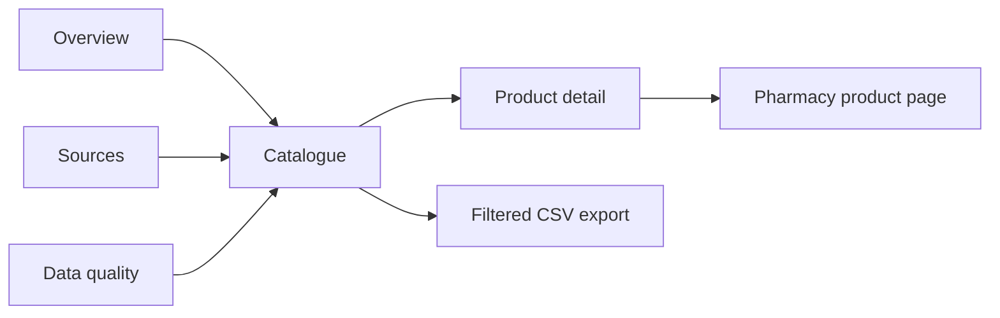

# Kenya Pharmacy Availability Dashboard: revamp plan

Prepared 14 October 2026 · Expanded after skill review · Implementation has not started

## 1. Objective

Revamp the dashboard into a calm, precise, white-dominant workspace for comparing pharmacy catalogue listings, reported stock evidence, prices, and data quality across sources.

The central question is:

> What do the available pharmacy sources report about this product, at what listed price, and how trustworthy and recent is that evidence?

Preserve the product's analytical depth while making the first useful finding easier to reach. The quality bar is deliberate hierarchy, readable data, consistent interactions, and honest evidence. “Apple-grade polish” is a craft reference, not a reason to imitate Apple's interface or remove useful density.

This document curates the supplied brief against a limited read of the repository. It is not a completed visual, accessibility, performance, or data audit. The live deployment has not been inspected for this planning pass.

The scope now includes a pre-revamp clinical-reference/data-refresh tangent, requested on 14 October 2026. Read [CLINICAL_DATA_PLAN.md](CLINICAL_DATA_PLAN.md) for measured field coverage, workbook/export structure, licensed API requirements, and the medicine-dossier display direction. Do not begin the main rebuild by assuming the reference is complete or current.

## 2. Baseline and scope

The implementation lives in `06_Dashboard/`. The inspected source uses React, Vite, JavaScript/JSX, plain CSS, custom SVG charts, a columnar browser store, and a DuckDB/Parquet pipeline outside the browser. There is an existing token layer, URL filter serialization, windowed rendering, CSV export, and a theme toggle. Preserve useful foundations after verification; rebuilding every working subsystem is unnecessary.

The existing destinations are Overview, Catalogue, Sources, and Data quality, selected through the `v` query parameter. Product detail is implemented within Catalogue. Confirm every reachable surface and state during Phase 0.

Read `CONTRACT.md`, `package.json`, and the source together. Older `PLAN.md` entries describe superseded choices, and some documented script descriptions and snapshot figures disagree. Treat executable behavior and verified contract semantics as the baseline; reconcile documentation instead of copying its historical numbers into the new UI.

### Included

- All existing views, filters, sorting, charts, tables, detail surfaces, exports, navigation, and feedback states.
- A single light design system, responsive layouts, revised copy, accessibility, and measured performance improvements.
- Removal of the theme toggle, alternate theme tokens, theme storage, and dark-mode branching, as explicitly requested in the brief.
- Appropriate metadata and crawlability improvements within the existing deployment architecture.
- Regression coverage, a component catalogue, and before/after evidence.
- A separately versioned clinical reference layer for source-supplied indications, mechanism, precautions, contraindications, adverse effects, contextual dosage, and special notes; interactions and pregnancy fields when actually supplied and licensed.

### Conditional or deferred

- Maps, geolocation, distance sorting, branch inventory, low-stock quantities, reservations, and purchasing: only if existing features and verified data support them. Otherwise record them as separate product proposals.
- New search semantics, default filters, route migrations, density controls, or changes to export contents: document their effect and obtain approval when they alter existing behavior.
- A framework migration, broad pipeline rewrite, full legacy TypeScript conversion, or new backend is outside the default revamp scope.
- Paid services, third-party analytics, and heavy dependencies require approval with a concrete justification.

## 3. Data truthfulness rules

These rules are acceptance criteria for every screen, chart, tooltip, export, and metadata claim.

| Concern | Required treatment |
|---|---|
| Reported stock | Distinguish the shop's raw `stock_state` from evaluated `stock_evidence`; aggregate using the latter. |
| Missing signals | Keep “Unknown,” “No stock signal,” and “Not listed” distinct where the model supports the distinction. None means in stock or out of stock. |
| Aggregate availability | Use `in_stock_rate_gated` for the headline. Preserve the raw rate only in its existing explanatory or sensitivity context. |
| Denominators | Use `pharmacies_eligible` for cross-source stockout measures. Carry absent and quarantined sources visibly with their reasons. |
| Freshness | Use verified per-source scrape timestamps for source freshness. Label inferred timestamps as inferred; never turn file mtime into “Updated 2 hours ago.” |
| Staleness | Treat freshness separately from stock state. Define any stale threshold from collection cadence and record it; do not invent a clinical expiry rule. |
| Low stock | Do not introduce this status without reliable quantity or an explicit source signal. |
| Prices | Identify listed minimum, median, maximum, or source price precisely. Preserve pack, strength, form, and match-confidence context. Missing price is not zero. |
| Classification | Keep provisional classification, contested matches, reference gaps, and unclassified buckets visible. |
| Coverage | Describe linkage within the catalogue, not completeness of the Kenyan market or the reference register. |
| Trends | A single snapshot cannot demonstrate a trend. Preserve an honest insufficient-history state. |
| Shortages | Preserve the contracted shortage-signal definition. Do not turn observed source stockouts into a claim of national shortage. |

Suggested disclaimer, subject to the copy pass: “Stock and prices reflect collected pharmacy listings. Confirm current availability and price with the pharmacy.”

Related products sharing an ingredient must retain identity and evidence context; the interface must not imply that they are clinically interchangeable.

## 4. Design direction

**Point of view:** an editorial data workspace with the clarity of a precision instrument.

| Decision | Direction | Rationale |
|---|---|---|
| Canvas | White primary surfaces; near-white recessed areas; restrained borders. | Keeps dense evidence readable and reduces competing visual weight. |
| Emphasis | Deep ink for primary actions, selected states, and a few compact accent surfaces. | Establishes hierarchy without making the page feel dark. |
| Accent | One restrained brand accent, selected after contrast testing. | Separates actions from status semantics. |
| Typography | One primary sans family, tabular numerals, a compact documented scale. | Makes prices, counts, and labels easier to compare. |
| Layout | Structured rows, aligned columns, clear section headings, generous grouping space. | Supports scanning without turning every fact into a card. |
| Status | Plain text plus a consistent icon or pattern, supported by color. | Preserves meaning for color-blind users and assistive technology. |
| Charts | Direct labels, explicit units and denominators, restrained axes, text/table alternatives. | Makes the evidence understandable without interpreting decoration. |
| Motion | Brief transitions that explain state changes; reduced-motion support. | Maintains orientation without delaying work. |

The proposed 85–90% light / 5–10% dark balance is a visual direction, not a pixel-count requirement. Avoid large dark sidebars or panels that dominate the canvas.

Define semantic tokens for surfaces, inverse foreground/background pairs, text, borders, focus, actions, stock evidence, data quality, spacing, typography, radii, elevation, motion, layers, and layout widths. Component colors and repeated measurements must come from tokens or documented variants. Structural CSS values such as `0`, `100%`, `auto`, and grid fractions do not need artificial tokens.

Self-host a suitably licensed font if a custom family is chosen, subset necessary glyphs, and use `font-display: swap` with compatible fallbacks. Reuse the existing icon set if it meets consistency and accessibility requirements.

## 5. Information architecture and responsive behavior

Preserve current URLs during the revamp. Confirm URL behavior against `encodeFilters` and `decodeFilters`; keep old shared links functional. Do not replace the existing query-based navigation merely to make URLs look cleaner.

| Destination | Existing URL | Primary task | Proposed hierarchy |
|---|---|---|---|
| Overview | `/` or `/?v=overview` | Understand the snapshot and investigate its signals. | Snapshot and caveats → focused summary → stockout evidence → source coverage → supporting analysis. |
| Catalogue | `/?v=catalogue` | Find and compare products. | Search → applied filters and result count → results → source-level detail. |
| Sources | `/?v=sources` | Assess source coverage and feed reliability. | Coverage summary → source comparison → health and absence explanations. |
| Data quality | `/?v=quality` | Understand uncertainty and review priorities. | Match/classification summary → review and reference gaps → methods and provenance. |

Navigation should expose all four destinations, indicate the current view, and keep search and export discoverable. Contextual links should take users from a signal or quality issue to the corresponding filtered Catalogue. Preserve existing drill-down behavior and verify restoration of filters and focus.

Capture reference screenshots at 375, 768, 1280, and 1920 px. These are verification widths, not automatically the CSS breakpoints. Also test reflow at 320 CSS px and zoom at 200%.

- **Phone:** compact navigation; prominent search; filters in an accessible sheet if appropriate; readable result summaries with all analytical fields reachable through details. Preserve filter values when the sheet closes.
- **Tablet:** selectively persistent filters; fewer simultaneous data columns; a detail layout that fits without crowding.
- **Desktop:** aligned comparison tables, useful sticky headers, stable filter access, and readable detail panels.
- **Wide desktop:** bounded reading width and deliberate column expansion. Do not stretch prose or multiply decorative summary cards.

Format KES and numbers consistently using `en-KE`. Store source timestamps with their original timezone information and define the display convention explicitly, normally Africa/Nairobi. Prepare reusable strings for future localization; a Swahili translation is a separate deliverable unless requested.

## 6. Delivery phases

The order deliberately establishes data truth and information architecture before rebuilding components. Copy, accessibility, and performance are continuous requirements, with dedicated final passes.

### Data preparation — before Phase 0 implementation

Profile and export existing clinical references; stage new pharmacy captures with timestamps and a complete refresh-status roster; validate coverage, record identity, source text, and contract compatibility. Prepare the paid API adapter boundary using real documentation when available. Preserve historical files and the current dashboard snapshot. Clinical-reference collection dates remain unknown where the source does not provide them. See `CLINICAL_DATA_PLAN.md` for the exit gate and UI implications.

### Phase 0 — Audit and baseline

1. Confirm repository boundaries, local instructions, deploy configuration, and existing commands.
2. Inventory every feature, URL parameter, filter, sort, export field, chart, drawer, loading state, error, and empty state.
3. Run locally and capture every view plus major states at the four reference widths. Use a repeatable dataset and record its identifier.
4. Record baseline bundle/data transfer sizes, load stages, performance measurements, accessibility issues, and keyboard behavior.
5. Map UI fields to their data sources, uncertainty, denominators, and timestamps. Define each headline metric's grain, numerator, denominator, exclusions, and filter scope; trace representative records from the browser model to source evidence.
6. Separate verified defects from subjective visual preferences; do not assume the interface is generic before inspecting it.

**Deliver:** `docs/revamp/AUDIT.md`, feature/state matrix, baseline screenshots, prioritized backlog, and a short diagnosis.

**Exit gate:** every existing feature has a preservation check; baseline failures are recorded; blocking product/data decisions are isolated. Phase 0 must not regenerate source data, overwrite exports, or modify application code. Run mutating verification commands later against isolated inputs when needed.

### Phase 1 — Information architecture and design system

1. Document each view's question, evidence order, navigation, responsive treatment, and states.
2. Define semantic tokens and reusable layout primitives; document active contrast pairs.
3. Create representative designs for Catalogue, product detail, Overview, and a difficult data-quality state.
4. Establish a concise voice guide and status terminology.
5. Document existing-to-proposed behavior mappings, including the explicitly requested theme removal. Give each component documented props, applicable states, keyboard behavior, screen-reader announcements, and token dependencies.

**Deliver:** `DESIGN.md`, tokens in code, route wireframes, and decision log with one-line usability rationales.

**Exit gate:** the representative designs cover phone and desktop, inverse surfaces pass contrast checks, and no unsupported product claims enter the designs.

### Phase 2 — Foundations and first complete workflow

1. Implement layout, typography, buttons, fields, labels, chips, status indicators, overlays, and feedback primitives.
2. Replace theme switching with `color-scheme: light`; remove alternate theme state/styles and align `theme-color`.
3. Complete one end-to-end workflow: search → filter → compare results → open product detail → visit source or export.
4. Preserve existing facet-count semantics, query serialization, sorting, windowing, and export contracts.
5. Add applicable states to a lightweight development-only component catalogue. Reuse existing tooling before introducing Storybook.

**Exit gate:** the workflow works by touch and keyboard, URLs reload correctly, exports preserve their agreed schema, and changed components have relevant state coverage.

### Phase 3 — All remaining surfaces

1. Rebuild Overview, Sources, Data quality, and remaining Catalogue/detail elements using the same system.
2. Align chart legends, provenance, prices, counts, confidence indicators, and missing-data treatment.
3. Implement meaningful loading, partial-data, offline, failure, retry, and insufficient-history states.
4. Finish responsive layouts and accessible chart alternatives. Keep comparable scales aligned, start magnitude bars at zero, and represent missing evidence distinctly from a measured zero.
5. Keep technical repair instructions out of public error messages; provide a useful recovery action and appropriate diagnostic logging.

**Exit gate:** every audit-inventory item is accounted for, and no destination depends on a separate visual language or loses analytical fields.

### Phase 4 — Copy and public discoverability

1. Run copywriting → copy-editing → humanizer over all visible strings and metadata.
2. Keep wording specific about listings, source evidence, uncertainty, and snapshot dates.
3. Define the public indexing policy: which views are useful public content, which filter combinations are duplicates, and which surfaces should remain unindexed.
4. Add accurate titles, descriptions, canonical behavior, language, share metadata, robots, sitemap entries, and a designed share image where appropriate.
5. Evaluate prerendering for stable public content within the existing Vite setup. Propose a framework migration separately if truly necessary.
6. Use structured data only for verified entities and properties. Assess applicability during implementation rather than promising search features.
7. Propose a privacy-respecting measurement plan; do not install third-party tracking without approval. Exclude raw medicine searches, product identifiers, ingredient/category selections, and query-bearing URLs from event payloads. See `REVAMP_SKILLS.md` for the proposed minimal event plan.

**Exit gate:** copy introduces no live-stock, nearby-branch, clinical, completeness, or national-shortage claims beyond the evidence; crawler-visible content and canonical behavior are checked for the chosen indexing policy.

### Phase 5 — Engineering hardening

1. Add strict typing for new or substantially rewritten boundaries and components, with a scoped migration for touched JS/JSX. Avoid a broad conversion unrelated to the revamp.
2. Add lint, formatting, type-checking, and targeted test commands, since the inspected package does not currently expose all these gates.
3. Test filter logic, URL round trips, sorting, missing-value formatting, evidence semantics, and CSV integrity.
4. Test overlay focus, Escape/close behavior, result announcements, error recovery, and keyboard-operable charts. Cover focus restoration, focus visibility beneath sticky content, virtualized-table semantics, and asynchronous detail-loading races.
5. Add Playwright smoke coverage for all four views and the complete Catalogue workflow, with automated axe checks.
6. Measure before optimizing. Preserve the lightweight browser model; lazy-load expensive surfaces and avoid reintroducing a browser query engine.
7. Add bounded retries for transient read-model failures, prevent mismatched snapshot files, and make any cached-data fallback explicit about its age.

**Exit gate:** agreed checks pass; the existing pipeline contract verification remains effective; the Vercel build still succeeds. Any TypeScript coverage outside migrated code is reported honestly.

### Phase 6 — Final verification and release preparation

1. Re-capture the baseline matrix using the same fixture, viewport, browser, and capture conditions.
2. Run mobile Lighthouse and axe on every destination; manually cover drawer, filter, empty, and failure states.
3. Walk the critical workflow with keyboard and a real screen reader, recording browser/assistive-technology versions. If unavailable, record that gap explicitly.
4. Verify every used text, control, focus, and meaningful chart contrast pairing, including inverse surfaces.
5. Check feature parity, shared links, filtered export, data semantics, reduced motion, zoom, reflow, and slow networks.
6. Prepare the review, evidence, deployment preview, and a rollback reference. Production deployment follows the authorized release process.

**Exit gate:** no unresolved critical/high defects or unexplained regressions; remaining limitations are listed with their impact. Fix and re-run affected checks after changes.

## 7. Acceptance and measurement

| Area | Acceptance evidence |
|---|---|
| Behavior | All inventoried features and data contracts preserved; approved exceptions listed. |
| Theme | One light theme; no toggle, alternate palette, stored theme preference, or color-scheme branching. |
| Accessibility | WCAG 2.2 AA evaluated through an applicability matrix and automated/manual checks; visible and unobscured focus, semantic controls, usable keyboard paths, and alternatives to dragging where relevant. Automated passes alone are not a conformance claim. |
| Touch/reflow | Product target of 44 CSS px hit areas for interactive controls; usable at 320 CSS px and 200% zoom without lost content or actions. |
| Contrast | At least 4.5:1 for normal text, 3:1 for large text and relevant non-text UI; verify actual backgrounds and opacity. |
| Performance | Aim for LCP <2.5 s, INP <200 ms, CLS <0.1. Record device, network, fixture, and repeated-run results. |
| Interaction performance | Lighthouse alone does not establish INP. Use interaction traces in the lab and field measurement if available; distinguish estimates from field results. |
| Transfer budget | Record current production JS, CSS, fonts, and data transfer; set numeric budgets in Phase 0 and explain any increase. Documentation figures are not fresh measurements. |
| Copy/data | No invented stock, freshness, location, trend, price, coverage, or clinical claims. |
| Engineering | Build, lint, format, scoped strict type checks, targeted tests, and contract verification pass. |
| Visual quality | Consistent tokens, deliberate hierarchy, readable tables, aligned numerals, meaningful emphasis, and no ornamental filler. |

Suggested usability exercise: ask representative users to find a product, compare reported source availability and price, explain the freshness caveat, and share or export the finding. Record completion and misunderstandings. Define the timing target after the baseline exercise; do not claim user validation from internal QA.

## 8. Priorities and working agreement

- **P0:** preserve data meaning, routes, filters, exports, and contracts; fix blocking accessibility and workflow failures.
- **P1:** establish the light system, search/results/detail workflow, responsive hierarchy, consistent copy, and all four views.
- **P2:** polish secondary interactions, optimize measured bottlenecks, improve applicable discoverability, and add only justified enhancements.

Keep a current task list linked to the audit inventory. At each implementation phase, run the applicable build and quality gates, record evidence, and make a focused commit. Never claim that an unavailable or unconfigured check passed. Stage only relevant files in the actual dashboard repository; preserve unrelated workspace changes.

Make reversible visual and implementation decisions autonomously and record them in `DESIGN.md`. Seek input only for an unresolved choice affecting behavior, data contracts, unsupported capabilities, significant dependency cost, or irreversible release actions. Prepare the concrete proposal and impact before asking.

## 9. Skill usage

Thirty relevant skill entrypoints have now been reviewed, including the two used for the initial plan. Their phase mapping, applicability limits, tool inventory, and verification cases are recorded in [REVAMP_SKILLS.md](REVAMP_SKILLS.md). Read supporting references as their concrete implementation tasks arise; reading a skill does not mean its workflow has been executed.

| Work | Guidance |
|---|---|
| Design and interaction | `ui-ux-pro-max`, `design-system`, `design-critique`, `accessibility-review`, and `user-research`; `frontend-design` if available. |
| Hierarchy and navigation | `site-architecture`. |
| Copy | `ux-copy`, then `copywriting`, `copy-editing`, and `humanizer` as applicable. Preserve material uncertainty and caveats throughout. |
| Discoverability | `seo-audit`, `ai-seo`, and `schema-markup` where applicable. |
| Measurement proposal | `analytics-tracking`, without enabling third-party collection. |
| Data and charts | `validate-data` and `data-visualization`, adapted to the existing browser charts. |
| Engineering | `testing-strategy`, `code-review`, `debug`, `documentation`, `react-best-practices`, and `verification`. |
| Product and release | `write-spec`, `deploy-checklist`, `deployments-cicd`, and Vercel `knowledge-update`, subject to verified platform details. |
| Tools and assets | `computer-use`, `plugin-management`, and `imagegen` when their capabilities are actually needed. |
| Reusable QA workflow | `skill-creator` only if a useful repeatable workflow emerges. |

Skill guidance is advisory where it conflicts with this brief or the actual stack. Keep the single light theme, plain CSS, Vite architecture, honest data caveats, and existing behavior. Do not adopt React Native/Next.js examples, conversion tactics, library migrations, or numerical SEO gains without applicable evidence.

Bundled Python and Node were located during the follow-up tool review. The UI/UX helper remains unavailable because its referenced `scripts/search.py` file is absent from the installed skill package. No runtime or plugin was installed. `frontend-design` was not found in the skill catalogue or the searched local skill roots; use the reviewed design guidance and explicit visual criteria.

## 10. Deliverables and completion checklist

- [ ] `DESIGN.md`: principles, tokens, typography, status semantics, motion, voice, components, and decisions.
- [ ] Audit report and prioritized feature/state inventory.
- [ ] Revamped interface across all four existing destinations and their states.
- [ ] Development-only component catalogue with applicable interaction states.
- [ ] Before/after screenshots and comparison notes at matching widths.
- [ ] Regression, accessibility, contrast, performance, and data-contract reports with reproducible commands and measurements.
- [ ] Metadata/indexing implementation and verification where applicable.
- [ ] Review summary: changes, preserved behavior, approved exceptions, known gaps, and next steps.
- [ ] Release/rollback notes and deployment verification when deployment is authorized.

**Next execution step:** resolve the outstanding data-preparation items recorded in `CLINICAL_DATA_PLAN.md`, then conduct Phase 0. Read-only baseline investigation can proceed independently; the main visual rebuild has not started.
